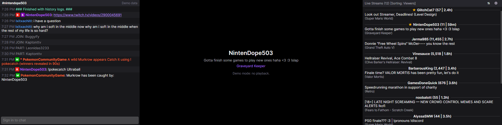

# StreamEdge

A cross-platform Twitch client for small ultrawide secondary displays, built with
[Avalonia](https://avaloniaui.net/). Chat, the stream, and your live follows sit
side by side in one short row.



> Early scaffold. Chat reading, sign-in, the followed-live list and stream
> resolution work; the video surface comes in phase 3. See [docs/PLAN.md](docs/PLAN.md).

## Build and run

Requires the .NET 8 SDK (or newer).

```sh
dotnet build StreamEdge.sln
dotnet run --project app/StreamEdge.App.Avalonia -- --demo          # sample data, no network
dotnet run --project app/StreamEdge.App.Avalonia -- --channel somechannel --screen 1 --fullscreen
dotnet test tests/managed/StreamEdge.Tests.csproj
dotnet test tests/ui/StreamEdge.UiTests.csproj
```

In VS Code, install the recommended **Task Buttons** extension to get
Build & Run / Demo / Test / Release buttons in the status bar.

## Signing in

1. Register an application at <https://dev.twitch.tv/console/apps> with
   **Client Type: Public** (any OAuth redirect URL, for example `http://localhost`).
2. Open ⚙ in the live-streams header, paste the Client ID and click **Sign in**.
3. Approve the code shown at twitch.tv/activate.

**Ad-free playback (optional):** if you're subscribed to a channel or have Turbo,
paste your browser's twitch.tv `auth-token` cookie into the same flyout. It is
stored encrypted (DPAPI on Windows) and sent only to `gql.twitch.tv`.

## Release

`pwsh scripts/build-release.ps1` publishes a self-contained single-file build for
the host OS into `dist/`. Pushing a `v*` tag runs `.github/workflows/release.yml`
for Windows, Linux (x64 and arm64) and macOS.

## License

GPL-3.0-or-later
